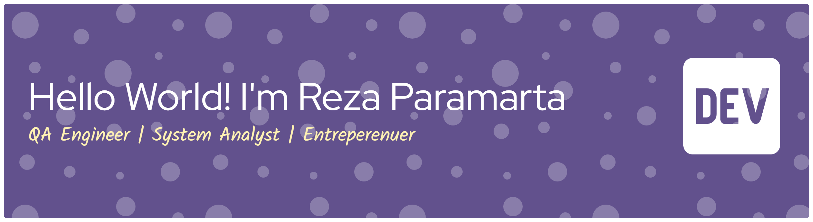

<!--
**rezaparamarta/rezaparamarta** is a ✨ _special_ ✨ repository because its `README.md` (this file) appears on your GitHub profile.

Here are some ideas to get you started:

- 🔭 I’m currently working on ...
- 🌱 I’m currently learning ...
- 👯 I’m looking to collaborate on ...
- 🤔 I’m looking for help with ...
- 💬 Ask me about ...
- 📫 How to reach me: ...
- 😄 Pronouns: ...
- ⚡ Fun fact: ...
-->
- 🔭 I’m currently working at PT. PNM Invesment Management
- 🌱 I’m currently using: Cypress, Playwright (TypeScript), Selenium, WebdriverIO, Appium, Katalon Studio, Robot Framework, Postman/Newman, Mocha/Chai, Qase, Jira, JMeter, K6 and GitHub Actions / GitLab CI / CircleCI.
- 🧠 I’m building AI-for-QA tools: ETCGA (LLM-powered test case generator) and a Qase Automation ToolKit.
- 🤔 I’m looking for QA Engineer job remote or onsite
- 📫 How to reach me: rparamarta7@gmail.com
- 😄 Pronouns: He/Him
- ⚡ Fun fact: I'm a huge fan of Oasis, Cristiano Ronaldo, and Basic Algebra (even though I'm not smart enough LOL)

##### Skills

**🤖 Test Automation** 
      

**💻 Programming Languages** 
        

**🔌 API Testing** 
      

**📋 Test Management** 
  

**🚀 CI/CD & Reporting** 
      

**⚡ Performance Testing** 
  

**🗄️ Databases** 
    

**🧠 AI-Assisted QA** 
    

**🛠️ Tools & Others** 
     

**📐 Methodology** 
    

##### Connect with me:

##### My Github Stats

##### Play games with me
<picture>
  <source media="(prefers-color-scheme: dark)" srcset="https://raw.githubusercontent.com/rezaparamarta/rezaparamarta/output/pacman-contribution-graph-dark.svg">
  <source media="(prefers-color-scheme: light)" srcset="https://raw.githubusercontent.com/rezaparamarta/rezaparamarta/output/pacman-contribution-graph.svg">
  
</picture>

###

